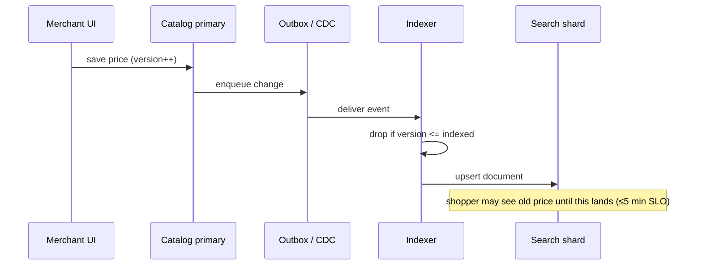
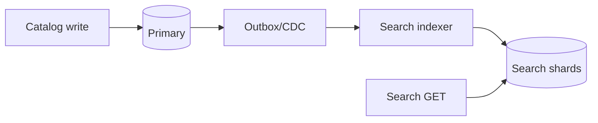

<!-- day-nav -->
[← Day 56 — Typeahead](56-typeahead.md) · [Day 58 — Video on demand →](58-video-on-demand.md)

# Day 57 — Product search

**Do now**

1. Set a timer.
2. Attempt the problem. Stop at the attempt line. Do not scroll.
3. Then read.

## Time box

40 minutes.

| Minutes | Do this |
|---|---|
| 0–12 | Attempt. Catalog search with facets. Explain lag after a write. |
| 12–32 | Read. Typeahead is not enough. Primary DB full scan is not a search engine. |
| 32–40 | Say inverted index + facets, and the bound between catalog write and searchable. |

## Intent

Facing catalog search rather than a prefix, leave able to query an inverted index with facets and explain lag after a write.

## Problem

> Design product search.
>
> Shoppers search a product catalog by keywords and filter by facets such as brand, price range, and category. A newly added or updated product should become searchable within a bound you state.

## Attempt before reading

12 minutes. Do not scroll.

Write:

1. Query API: text + facets + sort + page.
2. Index structure (inverted index). What a document contains.
3. How facets are computed without scanning every hit.
4. Write path: catalog primary vs search index; dual write vs CDC/outbox.
5. Lag: "I updated the price; search still shows old" — bound and user-visible behavior.

---

**Stop. Search replica via CDC. Facets from the index. Lag is spoken.**

---

## Requirements

**In.** Keyword search over title/description/attrs. Facets: brand, category, price bucket, availability. Page size 20. Sort by relevance or price. **Near-realtime** freshness: **≤ 1 minute** typical, **≤ 5 minutes** SLO.

**Assumptions.** **50 million** products. **5,000** search QPS peak. Catalog updates **500**/s peak. One region. Average query is 2–3 tokens; top 1% of queries are one-word brand names that hit millions of docs before filters.

**Out.** Typeahead (day 56), personalized ranking models, image search, voice, multi-warehouse inventory truth (search may show stale availability — link to day 49/61 carefully).

## Estimates

Index size: 50e6 × ~2 KB analyzed ≈ **100 GB** order — sharded. Query 5k QPS with replica set. Update 500/s into index pipeline.

| Item | Math | Result |
|---|---|---|
| Index size | 50M docs × ~2 KB analyzed fields + facets | **~100 GB** on disk (compressed postings smaller; planning figure stays ~100 GB) |
| Shard count | 100 GB / ~30–40 GB per shard primary | **~3–4 primary shards**, × replica factor 2 → **6–8** data nodes |
| Catalog → index | 500 updates/s × ~2 KB | **~1 MB/s** into the indexer — tiny vs query fan-out |
| Hot-query cache | Top 1k query+filter keys × ~20 KB cached page | **~20 MB** — fits in one process |
| Posting-list fan-in | "shoes" might hit 2M docs; intersect with brand=Nike (~50k) | Engine intersects sorted lists; you never scan 50M rows |

**What the table tells you.** Bytes are fine. The cliffs are facet cardinality, hot one-token queries that explode recall before filters, and pretending the primary database can do this with `LIKE` + `GROUP BY`.

Facet explosion: high-cardinality facets (SKU) refused; brand/category ok.

## API and data

`GET /v1/search?q=&brand=&category=&price_min=&cursor=`

**Catalog primary:** source of truth for product row.

**Search documents:** `product_id`, analyzed fields, facet fields, `updated_at`, `version`.

## Design

### Query path — parse → recall → rank → page

Shopper query is not one hop. Say the stages out loud:

1. **Parse.** Tokenize (`red running shoes` → `red`, `running`, `shoes`), drop stop words if your language needs it, apply a light stemmer, expand synonyms (`sneaker` → `shoe`). Keep the original tokens too — over-stemming turns `university` and `universe` into the same term and wrecks precision.
2. **Recall.** Look up each token's **posting list** (the sorted list of product ids that contain that token). Intersect or union the lists per the query (AND for multi-word retail search is the default). Apply facet filters as bitsets or as additional posting lists on brand/category/price-bucket fields. Cap recall — e.g. first **1,000–10,000** candidates after filters — before you spend CPU on scoring.
3. **Rank.** Score the candidates (BM25-ish term match, plus boring boosts: title match > description, in-stock first, sales velocity). This is statistical ranking, not a neural model in this interview.
4. **Page.** Return 20 docs + facet counts for the filtered set. Cursor/search_after on `(score, product_id)`, never a deep `OFFSET 100000`.

**Do not** query MySQL with `OR LIKE`. That path dies under facet aggregation and under 5k QPS.

### Inverted index, in one breath

A document is one product. For each term, the index stores a **posting list**: sorted product ids (plus optional positions for phrase queries). "Nike" → `[12, 88, 401, ...]`. Multi-term query = intersect those sorted lists. Facet fields live on the document (or as docvalues) so "brand=Nike" is another list or bitset, not a SQL `DISTINCT`.

**Sharding.** Hash `product_id` across shards so each product lives on one primary. A query fans out to all shards, each returns local top-K + local facet counts, the coordinator merges. Refuse routing by brand alone — one mega-brand then owns a hot shard.

### Typo tolerance without melting recall

Edit-distance on every token against a 50M-term dictionary at query time is too slow. What shops actually ship:

| Approach | How it works | Use when | Cost |
|---|---|---|---|
| Edge n-grams at index time | Index `nik`, `nike` as prefixes of `nike` | Prefix-ish typos on short brand tokens | Index bloat; keep n-gram length capped |
| Term suggest / fuzzy rewrite | If exact term misses, rewrite to closest dictionary term (edit distance 1–2) **once**, then search exact | Rare typos on common terms | One extra dictionary lookup; must not rewrite popular exact terms |
| Synonym list | Merchant/curated map `trainer` → `shoe` | Known language gaps | Manual; wrong synonyms poison relevance |
| "Did you mean" only | Don't auto-rewrite; show a suggestion link | Ambiguous queries (`apple` the fruit vs the brand) | Safer; one extra round-trip if the shopper clicks |

**Quirk: fuzzy everywhere.** Turning on edit-distance-2 for every token on a 5k QPS cluster turns every query into a fan-out against the term dictionary. Default is exact; fuzzy is a fallback when recall is near zero, or a separate suggest call (day 56 territory).

### Freshness vs relevance

Two clocks, do not mix them:

- **Freshness** is indexer lag behind the catalog primary (SLO ≤ 5 minutes). A price change is "correct" once the new version is searchable.
- **Relevance** is how well the doc matches the query. A brand-new product with no sales history can still rank high on an exact title match — do not bury it forever behind a popularity signal, or merchants will file tickets the day they launch.

Say both bounds. "Search can show an old price for up to five minutes" is freshness. "New SKUs still appear on exact title match" is a relevance rule you choose on purpose.

### Hot query cache

Identical `q` + facet set + sort for head queries (`nike shoes`, empty-q category browse) dominate QPS. Cache the page-1 result and facet payload for **10–60 s** keyed by the normalized query string. Invalidate on a coarse clock, not per catalog write — at 500 updates/s you cannot bust every cache key. Stale page-1 for 30 s is inside the freshness SLO; a cache miss storm on a celebrity drop is the outage you actually fear.

### Indexing path

Catalog write commits to primary + outbox. Indexer consumes outbox (or CDC), applies doc upsert by version (ignore stale). Delete → tombstone remove from index.

**Refuse dual-write** app→DB and app→search without shared ordering — day 39.

### Facets

Compute from the candidate set or globally with filters applied in the engine. Price ranges as bucket fields at index time (`0–25`, `25–50`, …) — do not run `GROUP BY price` over floats at query time.

**Crossed facets.** Shopper ticks brand=Nike and category=Shoes; facet counts for *other* brands must reflect the Shoes filter (and vice versa), or the UI lies. Engines do this with bitset intersections over facet fields. You do not re-query the primary for counts.

### Availability

If inventory is another system, search holds a **denormalized** bool/stock bucket updated async — can be wrong for minutes. Click-through rechecks truth (day 49). Say "search is not the reservation authority."

### Lag the user sees

Merchant saves title; search may show old for up to 5 minutes. Admin UI reads primary. Shopper search reads index. Support ticket: check indexer lag metric.

### Worked path: merchant save → searchable

1. Merchant UI writes catalog primary; outbox row with `version++`.
2. Indexer applies upsert if `version > indexed_version`; else ignore.
3. Shopper query: parse → posting-list recall → facet bitsets → BM25 rank → page 20.
4. Click product → PDP reads primary (and inventory authority). Search card can be stale; money path is not.

**Support playbook.** Merchant says "I changed the price." Check `indexer_lag_seconds`. If under SLO, wait; if over, page indexer. Do not "fix search" by writing the primary from a search admin tool.

**Schema gate.** New facet fields require a mapping change + reindex plan. Free-form merchant JSON as facets is how clusters die.

### Worked math you say out loud

"50 million products, about 2 KB a document → roughly 100 GB to shard. Peak 5,000 search QPS fans out to every shard; 500 catalog updates a second into an outbox is only about a megabyte a second, so freshness is an indexer-lag problem, not a bandwidth problem. I will not run `LIKE` and `GROUP BY` on the primary for this."

## Diagrams

Caption: "Primary is truth. Search is derived. Lag is the gap between them."

## Failure the user sees

**Indexer down.** Search increasingly stale; page on lag (seconds behind primary) and on dead consumers. Shoppers find old prices; checkout revalidates against catalog/inventory truth. Merchant admin UI must read primary — if support only checks search, they will gaslight the merchant.

**Search cluster red.** 503 on search; optional degraded browse from primary categories. Do not fail the whole site homepage if only search is sick — isolate.

**Mapping explosion.** Too many dynamic fields; refuse merchant arbitrary attrs as indexed facets without a schema gate. One bad product type must not map-bomb the cluster.

**Version go-backwards.** CDC delivers an older update after a newer one; indexer must ignore lower versions or you resurrect old prices. Version on the document is mandatory.

**Dual-write without outbox.** App wrote DB then failed before search (or the reverse): silent drift forever. Refuse; outbox/CDC only (day 39).

**Hot one-token query.** `q=shoes` with no facets recalls millions of docs. Cap candidate set before scoring; require a filter or a second token before you spend full BM25 on the tail. Uncapped recall is how p99 turns into multi-second searches during a sale.

**Cache stampede on a drop.** Celebrity product launches; every shopper types the same string; cache expires; all 5k QPS miss together. Single-flight the rebuild of that key (one filler, others wait) or keep a slightly stale copy while refreshing.

## Trade-offs

**Sync index on write vs async.** Sync makes write latency track search cluster — refuse for 500/s catalog with a 5 minute SLO.

**Exact inventory in search.** Refuse as authority; denormalize hint only.

**Name the refusal inside each alternative.** Against LIKE/GROUP BY on the primary for shopper search: you refuse OLTP death under facet aggregation. Against dual-write: you refuse undetectable drift. Against zero-lag search as a promise without making search primary: you refuse a lie. Against high-cardinality SKU facets: you refuse facet explosion. Against search as reservation authority: you refuse oversell theater (day 49/61). Against fuzzy-on-every-token: you refuse a dictionary fan-out tax at 5k QPS.

**10× catalog updates.** ~5k/s into the pipeline. Indexer parallelism and shard count; freshness SLO unchanged unless you tighten it on purpose.

## Talking points

**If they put search on the primary.** "Full-text on OLTP collapses under QPS and facet aggregation. Derived index."

**If they ask zero lag.** "Then search is the primary or you accept 2PC. For catalog, minutes are OK; money paths recheck."

**If they ask how facets stay fast.** "Facet fields on the documents / docvalues in the engine. Not a SQL DISTINCT on 50 million rows at query time."

**If they ask what the shopper sees at 4 minutes of lag.** "Old title/price in search cards. PDP and checkout read truth. I state the five-minute SLO up front."

**If they ask about deleting a product.** "Primary delete + outbox; indexer removes the doc. Search may show a ghost until lag clears — click-through 404s from primary."

**If they ask about typos.** "Exact match by default. Fuzzy or n-grams as a fallback when recall is empty — not edit-distance on every token at 5k QPS."

**If they ask how you shard.** "By product_id hash so brands spread. Query fans out; coordinator merges top-K and facet counts. I refuse brand-only routing."

## Say this in the room

Product search is an inverted-index cluster fed by CDC from the catalog primary, with facets stored on the documents so filters do not scan the catalog database. A query parses tokens, recalls candidates from posting lists, ranks with BM25-ish scoring, and pages twenty results — never a deep SQL offset. Writes commit to the primary first; the index can lag up to about five minutes, and I page on that lag. Availability in search is a hint — reservation still happens on the inventory authority. I refuse dual-writing the app to database and search without an outbox, I refuse merchant-defined arbitrary facet fields without a schema gate, and I refuse fuzzy matching on every token as the default. Relevance is statistical term match, not a neural model in this interview.

### Staff depth: search is not inventory authority

Denormalized `in_stock` in the index can be wrong for minutes. Checkout re-reserves (day 49/61). Merchant admin UI reads primary for the price they just saved; shoppers may see old price until indexer lag clears — support reads the lag metric.

**Dual-write refuse.** Outbox/CDC only (day 39). Version on docs so late CDC events cannot go backwards.

**Facet cardinality.** Brand/category/price buckets yes; per-SKU facets no.

**Recall cap.** One-token head queries get a candidate ceiling before scoring, or p99 dies on sale day.

**What staff sounds like.** Freshness SLO spoken before relevance theater; facets from the engine, not a primary GROUP BY; money paths recheck truth; parse → recall → rank said as three steps.

### More probes, with the answer

**"What pages?"** Name the user-visible lag or error metric from Failure — not only CPU. **"What do you refuse?"** Pick one refusal from Trade-offs and say the lie it prevents. **"What is the sensitive assumption?"** The estimate that flips the design if wrong by 10×.

## Kit artifact

| Follow-up | You answer with |
|---|---|
| "Price just changed." | Primary has it; search SLO lag; checkout re-reads truth. |
| "How does a query run?" | Parse → posting-list recall → facet filters → BM25 rank → page 20. |
| "Why not LIKE on MySQL?" | Facet aggregation + 5k QPS kills OLTP; derived inverted index. |
| "Typos?" | Exact default; fuzzy/n-gram fallback when recall is empty — not always-on. |
| "Facet counts wrong after filter?" | Bitset intersect in the engine; never DISTINCT on the primary. |
| "Hot query / sale spike?" | Short TTL cache on normalized q+facets; single-flight rebuild on miss. |
| "Shard by brand?" | Refuse — one brand becomes a hot shard; hash product_id instead. |

## Design log

One line: your freshness SLO, and how indexer failure shows up to a shopper.

Next: [Day 58 — Video on demand](58-video-on-demand.md). Upload → transcode → CDN.

---

<!-- day-nav -->
[← Day 56 — Typeahead](56-typeahead.md) · [Day 58 — Video on demand →](58-video-on-demand.md)
