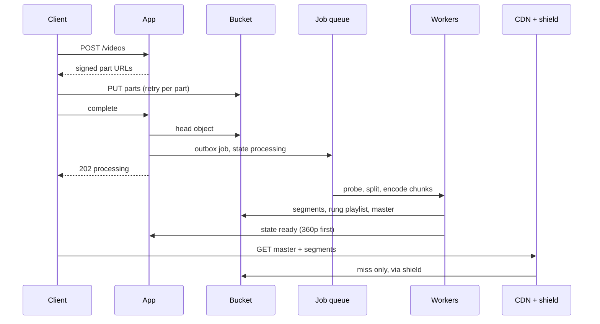
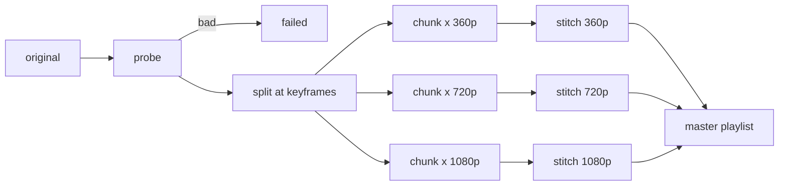

<!-- day-nav -->
[← Day 57 — Product search](57-product-search.md) · [Day 59 — Live video →](59-live-video.md)

# Day 58 — Video on demand

**Do now**

1. Set a timer.
2. Attempt the problem. Stop at the attempt line. Do not scroll.
3. Then read.

## Time box

40 minutes.

| Minutes | Do this |
|---|---|
| 0–12 | Attempt. Upload through transcode to CDN playback. Bytes off the app tier. |
| 12–32 | Read. If the app streams 4 GB files through itself, redo storage. |
| 32–40 | Say 202 vs ready-to-play, and where ABR renditions live. |

## Intent

Facing a long video, leave able to take upload through transcode to CDN playback without bytes sitting on the app tier.

## Problem

> Design video on demand.
>
> People upload a video. Viewers play it with adaptive bitrate. Playback should come from an edge, not from your application servers.

## Attempt before reading

12 minutes. Do not scroll. Day 28 image upload is the cousin; duration and ABR are new.

Write:

1. Upload: direct-to-object-store or through app?
2. When is upload "done"? When is video "playable"?
3. Transcode graph: renditions, packaging (HLS/DASH).
4. Playback path: manifest + segments on CDN.
5. Hot video egress math.

---

**Stop. Direct upload. Async transcode. CDN for manifests and segments.**

---

## Requirements

**In.** Upload up to **10 GB**, **≤ 3 hours**. Transcode to a ladder (360p / 720p / 1080p). Package as HLS or DASH. Play through a CDN. Owner delete. Status the owner can see: `uploading | processing | ready | failed`.

**Assumptions.** **100,000** uploads/day ≈ **1.2/s**. Mean original **500 MB**, mean duration **10 minutes**. **50** views per video over its life; hot titles dominate egress. One origin region; the CDN is global.

**Out.** Live (Day 59), recommendations, comments, the DRM license server (name Widevine and FairPlay as a dependency if asked), an editing suite.

## Estimates

Say these before you draw a single box. Every number below is an assumption you state, not a vendor fact.

| Quantity | Math | Result |
|---|---|---|
| Upload rate | 100,000 / 86,400 s | ≈ **1.2 uploads/s** |
| Original ingest | 100,000 × 500 MB | **50 TB/day** ≈ 4.6 Gbit/s average |
| Ladder bitrate | 0.8 + 3 + 5 Mbps (360p + 720p + 1080p) | ≈ **9 Mbps** of output per second of video |
| Renditions per video | 9 Mbps × 600 s ÷ 8 | ≈ **675 MB** |
| Renditions per day | 100,000 × 675 MB | ≈ **68 TB/day** |
| Total new storage | 50 + 68 TB | ≈ **118 TB/day** ≈ **43 PB/year** |
| Segment objects | 600 s ÷ 6 s × 3 rungs | **300 per video**, ≈ **30 M/day** |
| Video minutes to encode | 100,000 × 10 min | **1 M min/day** ≈ 16,700 hours |
| Encode CPU (assume 1 core-hour per rendition-hour) | 16,700 h × 3 rungs | ≈ **50,000 core-hours/day** ≈ **2,100 cores** busy on average |
| Average egress | 5 M views/day × 600 s × 3 Mbps ÷ 86,400 s | ≈ **104 Gbit/s** |
| Viral peak | 100,000 concurrent × 4 Mbps | ≈ **400 Gbit/s** |
| Origin load at 98% CDN hit ratio | 2% × 400 Gbit/s | ≈ **8 Gbit/s** |

Three things fall out of this table:

- **Storage, not compute, is the long-term bill.** 43 PB/year keeps growing. Move originals to a cold storage class once the ladder is built, and keep them, because re-encoding later (a new codec, a new rung) needs the original.
- **The app tier never sees video bytes.** 4.6 Gbit/s in and 400 Gbit/s out are bucket and CDN numbers. The app handles metadata at about 1 request per second for uploads.
- **Size the encode pool from backlog, not uploads.** 2,100 cores is the average. Uploads spike in the evening, so the queue grows and drains. The metric is how old the oldest `processing` video is.

## API and data

`POST /v1/videos` → `{id, upload_id, part_urls[]}` with signed PUT URLs for multipart upload. State `uploading`.

`POST /v1/videos/{id}/complete` with the part list → head the object, check size and type, set `processing`, enqueue the job, return **202**.

`GET /v1/videos/{id}` → state, duration, available rungs, and the master playlist URL once `ready`.

`DELETE /v1/videos/{id}` → 202; objects removed by a background job.

Playlists and segments: `GET` through the CDN, authorized by a signed cookie or a token in the path.

**Video row:** `id, owner_id, state, duration_s, renditions[], original_key, error, created_at, version`.

**Object keys:**

- `vid/{id}/original`
- `vid/{id}/{rung}/seg_{n}.m4s` (immutable once written)
- `vid/{id}/{rung}/playlist.m3u8` (one media playlist per rung)
- `vid/{id}/master.m3u8` (lists the rungs that exist right now)

## Design

### Upload: signed multipart, straight to the bucket

The app signs. The client sends bytes to object storage directly.

- **Part size.** S3-style stores allow 5 MiB to 5 GiB per part and at most 10,000 parts. A 10 GB file in 64 MiB parts is about 150 parts. Each part retries on its own, so a dropped train Wi-Fi costs one part, not the whole upload.
- **Resume.** The client stores `upload_id`. After an app restart it lists parts already uploaded and sends only the missing ones.
- **Abandoned uploads.** Parts of an unfinished multipart upload still cost storage. Set a lifecycle rule that aborts incomplete uploads after, say, 7 days. Say that number; interviewers like the detail.
- **Complete.** Head the object. Check size against the declared size. Write `processing` and the job in one transaction (outbox), so you never get a row with no job or a job with no row.

### Probe before you burn CPU

The first job step reads the container headers with a tool like `ffprobe`: duration, codec, resolution, frame rate, rotation. Reject a 4-hour file, a file with no video stream, or a corrupt header right here. A bad file found after 3 core-hours of encoding is a waste you could have caught in 2 seconds.

Phone uploads bring two classic quirks. **Rotation metadata:** a portrait video stored sideways with a "rotate 90°" flag. Apply it, or every viewer tilts their head. **Variable frame rate:** phones vary frame timing to save power. Convert to a constant rate before segmenting, or audio drifts out of sync.

### Transcode: split, encode in parallel, stitch

A 3-hour original encoded start to finish on one machine takes hours per rung. Instead:

1. **Split** the original into chunks of about 1 minute, cut at keyframes.
2. **Fan out** one task per chunk per rung. A 3-hour video is 180 chunks × 3 rungs = 540 tasks.
3. **Stitch** each rung's chunks back together in order and write segments plus the media playlist.

Wall-clock time drops from hours to minutes. Total CPU stays the same. Each task writes to a derived key like `vid/{id}/720p/chunk_042`, so a retried task overwrites the same object. That makes retries safe.

**Fairness.** One creator uploading 500 videos at once should not starve everyone else. Use a per-owner cap on in-flight tasks, and put short videos on a fast lane so a 30-second clip doesn't wait behind a 3-hour lecture.

### Keyframe alignment: the quirk that breaks ABR

Adaptive bitrate (ABR) means the player switches between rungs as the network changes. It can only switch at segment boundaries, and only if every rung has a keyframe at the **same** timestamps.

Force a fixed keyframe interval (for example every 2 seconds) and closed GOPs (each group of pictures decodes on its own) on every rung. Make the segment length a multiple of that interval: 6-second segments, keyframes at 0, 2, 4, 6. Skip this, and switching from 720p to 1080p shows a frozen frame or a smear for a moment. Candidates who mention this sound like they've shipped video.

### Packaging: HLS, DASH, or both

HLS is required for Apple devices. DASH is common elsewhere. CMAF (fragmented MP4 segments) lets **one** set of segment files serve both: you write two small playlist formats that point at the same `.m4s` files. That halves segment storage compared with keeping separate HLS `.ts` and DASH copies.

Each rung's media playlist ends with `#EXT-X-ENDLIST` once complete. That tells the player the video is finished, not live.

### Ready means playable, not uploaded

The worked path:

1. The client uploads parts, calls `complete`, gets **202** and state `processing`.
2. The 360p rung finishes first (cheapest to encode). The worker writes its media playlist, then writes `master.m3u8` listing 360p, then flips the row to `ready`.
3. The 720p and 1080p rungs finish. The worker rewrites `master.m3u8` to include them.
4. A player that loaded the master early keeps playing 360p. The next one sees all three rungs.

Order matters: **segments first, media playlist second, master third, row last.** Flip the row first and a viewer can get a play button whose playlist returns 404.

### Playback: what the CDN caches, and for how long

| Object | Changes? | Cache TTL |
|---|---|---|
| Segments `seg_{n}.m4s` | Never | Long (days to a year), immutable |
| Rung playlist (complete) | No, once written | Long |
| `master.m3u8` | Yes, while rungs are added | Short (a few seconds) during processing, longer once the full ladder exists |

The quirk to call out: give the master a year-long TTL while it lists only 360p, and edge caches serve that 360p-only master for a year. Viewers never get 1080p.

**Origin shield.** Put one mid-tier cache between the edges and the bucket. When 200 edge locations miss on the same new segment, the shield collapses them into one bucket read. At a 98% hit ratio the origin sees about 8 Gbit/s during a 400 Gbit/s premiere.

**Private videos.** Sign each video's URLs with a short expiry. Each video has hundreds of segment URLs, so a signed cookie scoped to `vid/{id}/*`, or a token in the path prefix, is simpler than signing every segment URL.

### Delete

Delete the row (or tombstone it) and return 202. A background job removes objects and requests a CDN purge. Players holding a valid token may keep pulling cached segments until the token expires or the purge lands. So promise "new plays fail at once, existing sessions end within the token lifetime." Don't promise instant global blackout.

Workers that are mid-encode check the row before each write. If the row is gone, they stop and write nothing.

### Storage over time

Most views happen in a video's first weeks. After that:

- Move originals to a cold storage class right after the ladder is built.
- Move rungs of videos with no views in, say, 90 days to a cheaper class. If one gets popular again, the CDN and shield absorb the slower first read.
- **Per-title encoding** (Netflix described this in 2015) picks bitrates per video. A static slideshow at 1080p needs far fewer bits than a football match. It cuts storage and egress, and it costs an extra analysis pass. Offer it as a 10× lever, not a day-one requirement.

### Worked math you say out loud

"500 MB mean and 100,000 a day is 50 TB a day of originals. The ladder adds about 675 MB per 10-minute video, so roughly 118 TB a day, about 43 PB a year. That's why originals go cold after transcode. Egress averages around 100 Gbit/s, and one viral title at 100,000 viewers and 4 Mbps is 400 Gbit/s. The CDN carries that; the app carries metadata at about one request per second."

## Diagrams

Caption: "App signs. Bytes skip the app. Ready after the first rung. Play from the edge."

Caption: "Fan out by chunk and rung. Stitch per rung. The master grows as rungs land."

## Failure the user sees

**Transcode backlog.** Upload finished; play shows "processing" for an hour. Page on oldest `processing` age and queue depth. Autoscale workers on backlog age. Don't serve the original as a fallback: a 4 GB progressive file at one bitrate buffers on phones.

**Premiere origin storm.** A new hit video misses every edge at once. Users see buffering, not an API 500. Fix: origin shield, plus pre-warming the first segments of announced premieres.

**Bucket unavailable during upload.** Parts fail; the client retries with backoff and resumes from listed parts. Abandoned parts expire by the 7-day lifecycle rule.

**Ready with only 360p.** The user plays at once; 1080p shows up minutes later. If you wait for the full ladder before `ready`, the first play waits on the slowest rung. Say which you pick. Prefer early play.

**Rung switch glitch.** A frozen frame at every quality change means keyframes aren't aligned across rungs. Users call it "the video stutters on Wi-Fi."

**Delete while viewers watch.** New plays fail at once; cached segments may play until the token expires. Say the token lifetime.

## Trade-offs

**Ready on first rung vs full ladder.** First rung gets faster time to play at lower quality for a few minutes. Full ladder gets one quality story and slower first play. Pick first rung for consumer video.

**Chunked parallel encode vs whole-file encode.** Chunks cut wall-clock time and make retries small. The price is a stitch step and keyframe discipline. Whole-file is simpler and fine for 30-second clips.

**CMAF vs separate HLS and DASH.** CMAF stores segments once. Very old players may need legacy HLS `.ts`; say you'd keep a fallback only if analytics show those devices matter.

**Per-title vs a fixed ladder.** Per-title saves bits on easy content and costs an analysis pass. Fixed ladder is predictable. Start fixed; add per-title when egress is the top cost line.

**Name the refusal inside each alternative.** Against uploads through the app: you refuse 10 GB files on your app servers' network cards. Against "ready" on upload complete: you refuse a play button that 404s. Against the app serving segments: you refuse 400 Gbit/s through your tier. Against a year-long TTL on a growing master: you refuse viewers stuck at 360p. Against instant global delete: you refuse a promise immutable caches can't keep.

**10× uploads.** About 12/s, 500 TB/day of originals, about 430 PB/year total. Same topology. The bucket, the encode pool, and storage tiering grow. Egress at 10× is still a CDN contract.

## Talking points

**If they push bytes through the app.** "10 GB files times concurrent uploads saturate our network cards. The app signs; the client uploads to the bucket."

**If they ask when play works.** "Ready after the first playable rung, not on upload complete. 202 means the original is durable and the job is queued."

**If they ask why the player stutters on quality change.** "Keyframes aren't aligned across rungs. Fixed keyframe interval, closed GOPs, segment length a multiple of the interval."

**If they ask about DRM.** "Widevine and FairPlay sit on the packager as a dependency. The license server is out of scope unless you want to go there."

**If they ask what pages.** "Oldest processing age. Upload error rate. Origin bandwidth and CDN hit ratio. Not app 5xx on play, because the app isn't on the play path."

**If they ask about a failed transcode.** "Probe catches most bad files in seconds. Anything later marks failed and keeps the original. Retries are safe because outputs use derived keys."

## Say this in the room

Uploads go straight to object storage with signed multipart; each part retries on its own and incomplete uploads expire after 7 days. Complete returns 202 and enqueues a job that probes the file, splits it at keyframes, and encodes chunks for every rung in parallel. I mark the video ready when the 360p rung is playable and grow the master playlist as higher rungs land, so the master gets a short CDN TTL while segments are immutable and cached long. Keyframes are aligned across rungs so ABR switches cleanly. A viral title at 100,000 viewers and 4 Mbps is about 400 Gbit/s; the CDN and an origin shield carry it and the app never touches segments. Storage is the long-term cost, about 43 PB a year at these assumptions, so originals go cold after transcode.

### Staff depth: ready vs complete, write order, and viral egress

**202 is not ready.** 202 on complete means the original is durable and a job is queued. Ready means a playlist and its segments exist.

**Write order is the correctness story.** Segments, then rung playlist, then master, then the row. Any other order lets a viewer reach a 404.

**Viral egress.** 100,000 × 4 Mbps ≈ 400 Gbit/s. Say the number before the CDN brand.

**Backlog sizing.** Size workers from oldest-processing age. Uploads can look healthy while play is a desert.

**Storage bill.** About 118 TB/day at these assumptions. Cold originals and per-title encoding are the levers.

**What staff sounds like.** Direct upload, probe first, chunked parallel encode, aligned keyframes, ready on first rung, master with a short TTL, 400 Gbit/s said out loud.

### More probes, with the answer

**"What if a creator re-uploads the same file?"** Hash the original on complete. Same hash and same owner: point at the existing renditions and skip the encode.

**"How do you add a new codec next year?"** Re-encode from the cold originals in a low-priority queue. That's why you never delete originals after transcode.

**"What's the sensitive assumption?"** Mean duration. Double it to 20 minutes and encode CPU and rendition storage both double; uploads per second don't change at all.

## Kit artifact

| Follow-up | You answer with |
|---|---|
| "When can I play?" | Ready after the first playable rung; not on upload complete. |
| "Why 202 on complete?" | Original durable, job queued, nothing playable yet. |
| "Why does quality switching stutter?" | Keyframes not aligned across rungs; fixed interval, closed GOPs. |
| "What do you cache, and for how long?" | Segments long and immutable; master short while rungs are still landing. |
| "What's the biggest cost?" | Storage, about 43 PB/year here; cold originals, per-title encoding. |
| "What pages?" | Oldest processing age, upload errors, origin bandwidth, CDN hit ratio. |

## Design log

One line: whether upload bytes touched the app in your attempt, and the ready vs complete distinction.

Next: [Day 59 — Live video](59-live-video.md). Ingest, ABR, start stampede.

---

<!-- day-nav -->
[← Day 57 — Product search](57-product-search.md) · [Day 59 — Live video →](59-live-video.md)
