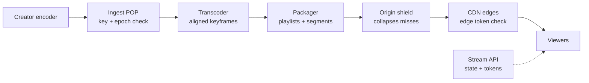
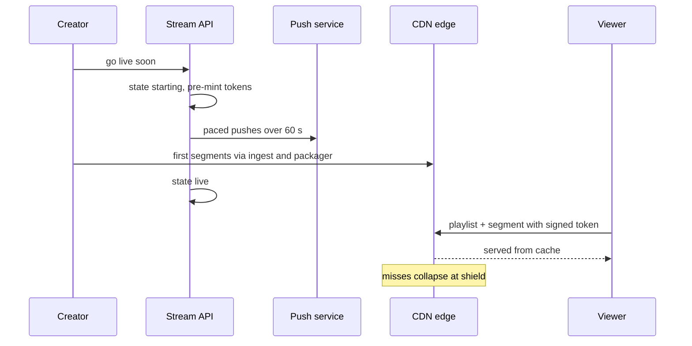

<!-- day-nav -->
[← Day 58 — Video on demand](58-video-on-demand.md) · [Day 60 — Nearby →](60-nearby.md)

# Day 59 — Live video

**Do now**

1. Set a timer.
2. Attempt the problem. Stop at the attempt line. Do not scroll.
3. Then read.

## Time box

40 minutes.

| Minutes | Do this |
|---|---|
| 0–12 | Attempt. Live ingest, ABR, stampede when the stream starts. |
| 12–32 | Read. VOD packaging is not live. DVR buffer is optional and named. |
| 32–40 | Say ingest path, glass-to-glass lag target, and start-of-stream protection. |

## Intent

Facing a live stream, leave able to ingest with adaptive bitrate and survive the stampede when the stream starts.

## Problem

> Design live video.
>
> A creator goes live. Viewers watch with adaptive bitrate. When a popular creator starts, many viewers join at once.

## Attempt before reading

12 minutes. Do not scroll.

Write:

1. Ingest protocol (RTMP/WebRTC/SRT) to what tier.
2. Transcode/packaging for live ABR; latency target (2–15 s vs sub-second).
3. Viewer join path; CDN for live.
4. Stampede when "LIVE" flips: metadata, manifests, chat (optional).
5. Disconnect and resume; what recording becomes VOD.

---

**Stop. Ingest edge → transcoder → live CDN. Protect the start stampede.**

---

## Requirements

**In.** Creator ingest. Server-side ABR (adaptive bitrate) ladder. Viewers via HLS or LL-HLS with **glass-to-glass ~5–15 s** (sub-second is a different product). Up to **5 million** concurrent viewers for top events. Optional DVR window **30–120 minutes**. Stream end → optional VOD asset (day 58).

**Assumptions.** **10,000** concurrent live streams, most tiny; **10** huge. Peak join rate at event start **100k connects/s** for about a minute.

**Out.** Ultra-low-latency betting, two-way interactive video as the main product, full chat redesign (pointer to day 54).

## Estimates

| Quantity | Math | Result |
|---|---|---|
| Ingest | 10,000 streams × 5 Mbps | **50 Gbit/s** into ingest POPs |
| Ladder output per stream | 5 + 3 + 1.5 + 0.8 + 0.3 Mbps (1080p…160p) | **~10.6 Mbps** |
| Viewer egress, top event | 5e6 × 3 Mbps avg | **15 Tbit/s**, CDN only |
| Viewer requests | 5e6 viewers × (1 segment + 1 playlist) every 2 s | **~5M req/s** at the CDN edge |
| Origin requests, one stream | 5 shields × 5 rungs × 2 files every 2 s | **~25 req/s** if the CDN collapses requests |

The last two rows are the whole design. Five million requests a second hit the edge; about 25 a second reach origin. That ratio only holds if the CDN **collapses** concurrent misses for the same URL into one upstream fetch. Say it by name.

## API and data

Creator: `POST /v1/streams` → stream key and ingest DNS name.

Viewer: `GET /v1/streams/{id}` → state + signed playback URL.

Stream row: `state` (idle | starting | live | reconnecting | ended), `ingest_region`, `publisher_epoch`, `media_sequence_base`, `chat_room_id`.

## Design

### Ingest

A geo-routed ingest POP terminates RTMP or SRT and checks the stream key. It forwards to a transcoder in the same region and reports health on input bitrate and keyframe cadence.

**One publisher, fenced.** The first connection takes a lease and bumps `publisher_epoch`. A second encoder with the same key either takes over (epoch + 1, old one kicked) or gets refused. The transcoder drops any input tagged with an older epoch. Without the epoch, two encoders race and viewers see the ladder flip between two cameras.

### Transcode and package

The transcoder emits a ladder of renditions, cut into short segments, plus a media playlist per rendition and one master playlist listing them.

- **Keyframes must line up.** Every rendition puts a keyframe at the same timestamps, every 2 s. Players can only switch rungs at a segment boundary that starts on a keyframe. If the source sends a keyframe every 10 s, the transcoder forces 2 s keyframes; a passthrough top rung can't, so ask creators for a 2 s keyframe interval.
- **Price ladders per stream, not per viewer.** Most of the 10,000 streams have a handful of viewers. A common policy: full ladder above a viewer threshold, passthrough plus one low rung below it. Transcoder count tracks streams.

### Latency budget

| Stage | Standard HLS, 2 s segments | LL-HLS |
|---|---|---|
| Encoder + ingest | ~1 s | ~1 s |
| Transcode + package | ~1–2 s | ~0.5 s, publishes partial segments |
| Player buffer | ~3 segments ≈ 6 s | a few partial segments |
| **Glass-to-glass** | **~8–10 s** | **roughly 2–5 s** |

Why 3 segments: the HLS spec (RFC 8216) tells players not to start less than three target durations from the live edge. Six-second segments push you past 20 s. **Segment duration is the main latency knob**, and shorter segments mean more requests per viewer.

### Cache rules

- **Segments are immutable.** Cache them long. A segment URL never changes content.
- **Media playlists change every segment.** TTL about half a segment duration (~1 s). Cache it for 30 s and viewers sit 30 s behind live.
- **Never cache a 404 for long.** A player that asks for the next segment a moment early gets a 404. If the CDN caches that 404 for a minute, every viewer at that POP stalls for a minute. Set negative-cache TTL to about 1 s or zero.
- **Origin shield** sits between edges and the packager. Edge misses collapse at the shield; shield misses collapse again. That's how 5M req/s becomes ~25.

### Start stampede

Bytes are already on the CDN. What melts at go-live is everything around the bytes.

1. **"Is live" metadata.** Served from the CDN with a 1–2 s TTL or held in a hot-key cache with singleflight (day 50). Fail toward `live` with a "starting" screen, not toward `idle`.
2. **Playback tokens.** Signed URLs or JWTs that the CDN edge verifies with a public key. No origin call per join. Pre-mint for notified followers when the stream enters `starting`.
3. **Push notifications, paced.** Sending 20M follower pushes in one second creates the stampede you're trying to survive. Spread them over ~60 s (day 55).
4. **Join shedding.** Over capacity → 503 with `Retry-After` and client jitter, a waiting room (day 70 cousin). Not an unbounded queue into the token service.

### Reconnect and failover

**Creator blip.** State goes `reconnecting` for a **15–30 s grace**. Playlists keep the last segments; players stall briefly. Reconnect bumps `publisher_epoch` and resumes. After grace: `ended`, then optional VOD finalize, async (day 58).

**Sequence numbers never go backwards.** A failover transcoder must continue from `media_sequence_base`, not restart at 0, and must mark the jump with `EXT-X-DISCONTINUITY`. Restart at 0 and players wait forever for a number they already passed. This is the quirk that separates "drew the boxes" from "ran it."

### Worked path: go-live minute

1. Creator taps "go live soon" → state `starting`; ingest assigned; tokens pre-minted; pushes start pacing.
2. First keyframe-aligned segments land → state `live`.
3. Viewers fetch master playlist → media playlist → first segment, all from the edge. Origin sees a few dozen requests a second.
4. Token edge-check passes with no origin call.
5. Capacity alarm → new joins get 503 + `Retry-After`; already-watching viewers are untouched.

### Worked numbers: paced pushes

Assume 20M followers and that 5% tap within the minute. That's 1M joins. Sent in one burst, most land in the first few seconds. Paced over 60 s, that's **~17k joins/s**, well under the 100k/s you sized for. Pacing is a cheaper control than buying capacity.

**Chat.** Store the day-54 room id on the stream row. Don't invent a second fan-out design mid-interview.

## Diagrams

Caption: "Bytes never return to the API tier. API is state and keys."

## Failure the user sees

**Transcoder death.** Brief stall. Failover continues the sequence with a discontinuity marker. Page on segment publish lag, not on API 200 rates.

**CDN regional issue.** Viewers in that region buffer; others are fine. Fail over to another CDN or POP. Still not your app tier.

**Cached 404 at an edge.** Every viewer on that POP stalls until the 404 expires. Page on per-POP stall rate.

**False `idle`.** Joins stop while the creator is live. Prefer false `live` with a "starting" screen driven by packager health.

**Token service melts.** Edge verification plus pre-minting removes it from the join path. If it still melts, shed with `Retry-After`, not 500 storms.

**Ingest blip longer than grace.** Stream ends; VOD may be partial. Say whether a restart is a new session or a resume.

## Trade-offs

**Segment length.** 2 s: lower latency, more requests, more keyframes (slightly worse compression). 6 s: cheaper, ~20 s behind live.

**LL-HLS vs standard HLS.** Seconds of latency saved for more requests and harder caching. Pick from the stated lag target.

**DVR.** Keep segments 30–120 min; playlists grow. Refuse unless asked.

**Name the refusal inside each alternative.** Against VOD-style single-file upload: you refuse wrong semantics. Against API-tier media: you refuse terabit egress. Against no join shedding: you refuse melting auth at go-live. Against sub-second WebRTC as the default: you refuse a different product. Against ending on first packet loss: you refuse mobile reality.

**10× viewers.** Still CDN. Collapsing and shields keep origin flat. Transcoders track streams, not viewers.

## Talking points

**If they reuse VOD upload.** "Live is continuous segments and reconnect semantics, not one file."

**If they ask glass-to-glass.** "About 8–10 seconds with 2-second HLS segments, roughly 2–5 with LL-HLS. Sub-second is WebRTC and a different deep dive."

**If they ask what melts first at go-live.** "Is-live metadata, token mint, and playlists. Not transcoders."

**If they ask why origin survives 5 million viewers.** "Request collapsing at edge and shield. Origin sees shields times rungs, not viewers."

**If they ask about transcoder failover.** "Continue the media sequence and mark a discontinuity. Never restart at zero."

## Say this in the room

Creators publish to a regional ingest POP with a stream key, fenced so only one encoder wins. Transcoders cut a keyframe-aligned ABR ladder into 2-second segments, and a CDN with an origin shield serves them: five million viewers at 3 Mbps is 15 terabits, an edge problem. Collapsing turns 5 million requests a second into a few dozen at origin. Glass-to-glass is about 8–10 seconds, mostly player buffer. At go-live the risk is metadata, tokens, and playlists, so I verify tokens at the edge, pace pushes, and shed joins with Retry-After. Ingest blips get a 15–30 second grace, and a failover transcoder continues the sequence number instead of restarting it.

### Staff depth: go-live is a metadata stampede

Bytes were planned for the CDN from minute one. The spike is "is live," tokens, and playlists. Edge-verified tokens, paced pushes, hot-key cache, and join shedding handle it.

**Two TTLs.** Segments cached long, playlists ~1 s, 404s ~0 s. One wrong TTL is a whole POP stalled.

**Fencing.** `publisher_epoch` on ingest; transcoder drops stale input.

**What staff sounds like.** Latency budget broken into stages; 15 Tbit/s said once; the collapse ratio said once; one quirk (sequence numbers or cached 404s) named without prompting.

### More probes, with the answer

**"What pages?"** Segment publish lag and per-POP stall rate. **"What do you refuse?"** Sub-second as the default; it's a different product. **"What is the sensitive assumption?"** The join curve at go-live. Paced, 1M joins is ~17k/s. Unpaced, if most land in the first 3 s, it's ~300k/s, three times what you sized for.

## Kit artifact

| Follow-up | You answer with |
|---|---|
| "Everyone joins at once." | Edge-verified tokens, paced pushes, shield + collapsing, shed with Retry-After. |
| "Why is it 10 s behind?" | Stage budget; player holds ~3 segments; shorten segments or LL-HLS. |
| "Transcoder dies mid-stream." | Failover continues media sequence + discontinuity marker. |
| "Two encoders, same key." | Publisher epoch; transcoder drops stale input. |
| "Viewers on one POP stall." | Check cached 404s and playlist TTL. |

## Design log

One line: your latency budget by stage, and one go-live stampede control.

Next: [Day 60 — Nearby](60-nearby.md). Geo index, staleness, privacy.

---

<!-- day-nav -->
[← Day 58 — Video on demand](58-video-on-demand.md) · [Day 60 — Nearby →](60-nearby.md)
