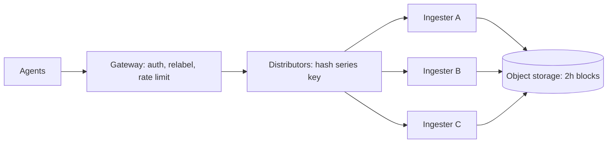
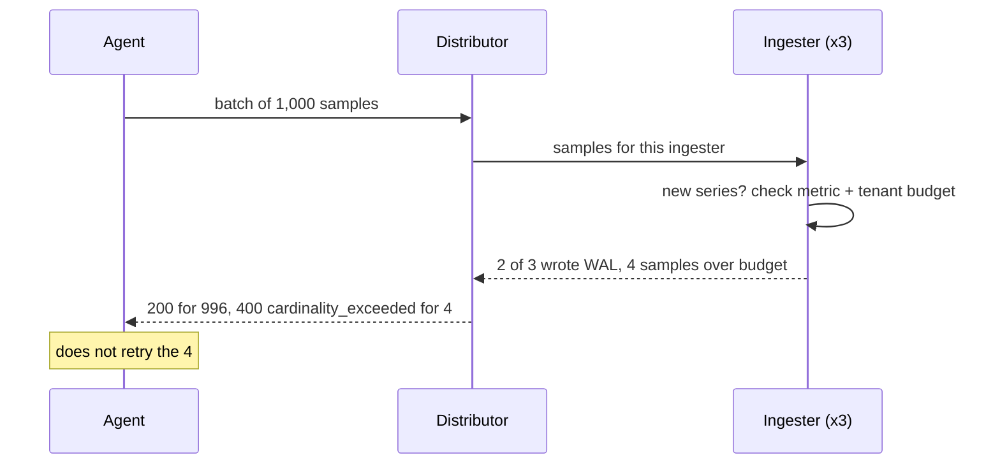

<!-- day-nav -->
[← Day 61 — Ticket booking](61-ticket-booking.md) · [Day 63 — Mock: job scheduler →](63-mock-job-scheduler.md)

# Day 62 — Metrics ingestion

**Do now**

1. Set a timer.
2. Attempt the problem. Stop at the attempt line. Do not scroll.
3. Then read.

## Time box

35 minutes.

| Minutes | Do this |
|---|---|
| 0–10 | Attempt. Firehose of measurements. Cardinality limit so one tenant cannot blow the store. |
| 10–28 | Read. If unbounded label combos are allowed, the store dies. |
| 28–35 | Say the write path, aggregation, and how you enforce cardinality. |

## Intent

Facing a firehose of measurements, leave able to ingest points with a cardinality limit so one tenant cannot blow the store.

## Problem

> Design metrics ingestion.
>
> Services send time-series metrics with labels. You store them for later query and alerting. One noisy tenant must not be able to create infinite series and take the system down.

## Attempt before reading

10 minutes. Do not scroll. Query/alerts are day 64.

Write:

1. Wire format and auth (tenant).
2. Write path: buffer, shard, durable store.
3. What a series key is; cardinality definition.
4. Enforcement when tenant exceeds series budget.
5. Out-of-order / duplicate points.

---

**Stop. Tenant-scoped cardinality. Append-optimized TSDB path. Shed new series hard.**

---

## Requirements

**In.** Multi-tenant push of gauges, counters, and histograms. Raw retention **15 days**; downsampled data lives longer (query day). Per-tenant limit on active series (e.g. **100k–1M**). At-least-once delivery from agents.

**Assumptions.** **10 billion** points/day ≈ **116k**/s average, **~500k**/s peak. **5,000** tenants; one whale. Agents batch about **1,000 samples per request**, so peak is roughly **500 write requests/s**.

**Out.** Full PromQL surface, log ingestion, a tracing backend, and alert rules (day 64).

## Estimates

**Bytes are small.** 500k points/s × ~20 bytes on the wire ≈ **10 MB/s**. On disk, time-series compression (delta-of-delta timestamps, XOR'd values) gets far lower; Facebook's Gorilla paper reports about **1.37 bytes per point**. Call it ~1.5 bytes: 10B points/day ≈ **15 GB/day**, × 15 days ≈ **225 GB**, × 3 replicas ≈ **675 GB**. Nothing here is hard.

**Series are big.** Assume **~4 KB of ingester memory per active series** (label index entry plus the open chunk). That figure is an assumption; say it out loud.

| Active series | RAM, one copy | RAM, 3 replicas |
|---|---|---|
| 1M | 4 GB | 12 GB |
| 10M | 40 GB | 120 GB |
| 100M | 400 GB | 1.2 TB |

The design fails on the right-hand column, not on MB/s.

## API and data

`POST /v1/metrics/write`, protobuf over HTTP, snappy-compressed, tenant from the API key (never from a header the client can spoof).

**Series identity.** `tenant + metric_name + labels sorted by name`. Sorting matters: `{a="1",b="2"}` and `{b="2",a="1"}` must be one series. Hash that canonical form (64-bit) for routing; keep the full labels in the catalog, because two series can share a hash.

**Store.** Per series: time-ordered chunks of ~120 samples. Per ingester: an in-memory head (last ~2 hours) plus a write-ahead log (WAL) on local disk. Every 2 hours the head is cut into an immutable block and uploaded to object storage.

## Design

### Ingest path

Gateway (auth, validate, relabel, rate limit) → distributors → ingesters → object storage.

- **Distributors are stateless.** They hash each series key onto a ring and send the sample to **3 ingesters** (replication factor 3).
- **Hash by series, not by request.** The same series must always land on the same ingesters, or compression and in-order append break.
- **Ack after 2 of 3** ingesters have written the sample to their WAL. That is the durability bar. Agents retry on 5xx.
- **Shuffle sharding.** Each tenant hashes to its own subset of ingesters (say 12 of 60). A whale hurts its 12; most other tenants share few or none of them.

### What a series costs

Cardinality multiplies. `http_requests_total` with `method` (5) × `status` (10) × `route` (50) × `pod` (200) = **500,000** possible series from one metric. Add `user_id` with 1M users and the ceiling jumps to **5 × 10¹¹**. Even if a tiny fraction show up, that is tens of millions of series, which the table above prices at hundreds of GB of RAM.

"Active" means the series got a sample in the last ~20 minutes. Pods die, so series churn; counting only live ones keeps a rolling deploy from tripping the limit on dead series.

### Where the limit is counted

Ingesters know their own series exactly, so enforce there. Give each ingester a local share of the tenant budget:

`local limit = tenant limit × replication factor ÷ shard size`

Worked: 1M × 3 ÷ 12 = **250k series per ingester** for that tenant. Hashing is not perfectly even, so the tenant can overshoot by a few percent. That is fine: you protect the store, you don't bill to the series.

If you also want a gateway-level estimate across the cluster, a HyperLogLog sketch with 4,096 registers gives about **1.6%** error in a few KB.

**Two layers of budget.**

- **Per tenant** (1M): protects the cluster from one customer.
- **Per metric name within a tenant** (e.g. 100k): one bad metric with `user_id` hits its own wall before it eats the whole tenant budget. The tenant's healthy metrics keep getting new series.
- **Global emergency fuse**: if many tenants spike at once, refuse all new series cluster-wide. Existing series keep writing.

### Reject, and say why

When a sample would create a series over budget:

- Accept the rest of the batch. Reject only the over-budget samples.
- Return **400 with `cardinality_exceeded`**, the metric name, and the limit. This is **not retryable**.
- Count every rejection in a per-tenant metric and page the tenant owner, not the site.

**The quirk: don't send 429 for cardinality.** Agents treat 429 and 5xx as "retry later." A series that is over budget will be over budget in 10 seconds too, so a 429 turns one bad label into an endless retry storm that grows the agent's queue and your request rate. Save 429 for **rate limits** (points per second), where waiting actually helps.

**Relabel rules at the gateway** run before any of this: drop a banned label like `user_id`, or drop a known-bad metric entirely, so the series never exists.

### Duplicates and out-of-order

- **Exact duplicate** (same series, timestamp, and value): drop quietly. At-least-once retries and 3 replicas make these normal.
- **Same timestamp, different value**: reject as a conflict and count it. Silent last-write-wins hides two agents scraping the same target.
- **HA agent pairs.** Teams often run two identical agents for redundancy. The gateway tracks one elected replica per cluster label and drops the other's samples, failing over if the leader goes quiet for ~30 s. Without this, every series doubles.
- **Out-of-order window.** Accept samples down to (newest sample in head − 1 h). Older ones are rejected, so a bad clock cannot rewrite history.

### Worked path: a point with a new label combo

1. Gateway authenticates the tenant, applies relabel rules (`user_id` dropped here), and checks the points/s rate limit (429 if over).
2. Distributor canonicalizes the labels, hashes the key, and picks 3 ingesters from the tenant's shard.
3. Each ingester checks: known series? Append. New series? Check the per-metric and per-tenant local limits.
4. Over budget → that sample is rejected with `cardinality_exceeded` (400). Under → create the series, write WAL, append to head.
5. Two of three ingesters confirm → distributor acks the batch, listing any rejected samples.

### Worked numbers

| Quantity | Value |
|---|---|
| Peak points/s | 500k |
| Peak requests/s (1,000 samples each) | ~500 |
| Wire bandwidth | ~10 MB/s |
| Disk, 15 days × 3 replicas | ~675 GB |
| Tenant limit / local share (RF 3, shard 12) | 1M / 250k per ingester |
| RAM for a 1M-series tenant, 3 replicas | ~12 GB |
| RAM if one tenant reaches 100M series | ~1.2 TB |

## Diagrams

Caption: "Limits before fan-out, counted where the series live. New series are the scarce resource."

## Failure the user sees

**Tenant over budget.** New series fail; dashboards miss new pods until the team drops labels. Old series keep writing, so the tenant sees a **partial** outage of discovery, not a write blackout. Page the tenant, not the whole site.

**429 retry storm.** Someone returns 429 for cardinality. Agents retry forever, request rate climbs 10×, and every tenant on that shard sees slow writes. Fix: 400 for cardinality, 429 only for rate.

**Ingester down.** With RF 3 and quorum 2, one dead ingester changes nothing. Two dead in the same shard → 503 for series hashed there; agents buffer and retry; gaps possible if the agent's buffer overflows. The WAL replays on restart.

**Whale tenant.** One of 5,000 tenants tries 50M series overnight. Its local limits trip at 1M; shuffle sharding keeps the blast to its 12 ingesters. The global fuse is the last resort.

**Silent drop misconfiguration.** Cardinality "fixed" by dropping points quietly. The customer thinks metrics work; weeks later the data is still wrong. Prefer an explicit, counted reject.

**Doubled series.** HA agent pairs without dedup double every series and halve the tenant's real budget.

**Out-of-order flood.** Agents with wrong clocks send ancient samples; the bounded window rejects them.

## Trade-offs

**Exact vs approximate counts.** Exact counts per ingester are cheap because each ingester only counts its own series. Approximate global counts (HyperLogLog) help dashboards. Overshoot by a few percent is acceptable; the goal is protecting RAM.

**Reject vs silent drop.** Reject, counted and visible. Silent drop hides cardinality bugs.

**Per-tenant only vs per-tenant plus per-metric.** Per-metric limits add config but stop one bad metric from blocking a tenant's healthy ones.

**Name the refusal inside each alternative.** Against unlimited label combos: you refuse catalog RAM death. Against silent drop as the default fuse: you refuse hiding the customer's bug. Against 429 for cardinality: you refuse retry storms. Against treating points/s as the scarce resource: you refuse missing the real cliff. Against one shared ingester pool for all tenants: you refuse a noisy neighbor (day 22). Against an unbounded out-of-order window: you refuse history rewrites.

**10× points.** ~5M/s means more distributors and ingesters; the **same** series budgets. The cardinality fuse does not loosen because bytes grew.

## Talking points

**If they index every label forever.** "That is how tenants melt you. Budgets, per-metric limits, and gateway drop rules."

**If they ask what the scarce resource is.** "Active series, not points. 10 MB/s is easy; at ~4 KB each, 100M series is over a terabyte of RAM with replicas."

**If they ask where you count.** "On the ingesters, each enforcing tenant limit × RF ÷ shard size. They own the series, so the count is exact locally."

**If they ask what status code.** "400 for cardinality, because retrying cannot help. 429 only for rate limits."

**If they ask how a new pod appears when over budget.** "It does not until they drop labels or we raise the limit. Existing series still write."

**If they ask about ack durability.** "After 2 of 3 ingesters write WAL. Agents retry on 5xx, so it's at-least-once; exact duplicates drop quietly."

**If they ask about query.** "Day 64. Today I keep the firehose from becoming an unbounded index."

## Say this in the room

Ingest is a hash-sharded write path into a time-series store with 3 replicas and a 2-of-3 WAL ack, but the scarce resource is active series, not raw points. Half a million points a second is about 10 MB/s; at roughly 4 KB of memory per series, 100 million series is over a terabyte of RAM. Each tenant has a series budget counted on the ingesters that own its series, plus a per-metric budget so one bad label can't block healthy metrics. Over-budget samples get a non-retryable 400 with a clear reason, never a 429 that turns into a retry storm, and never a silent drop. Exact duplicates drop quietly, conflicting values are counted, and out-of-order samples have a one-hour window. Query and alerts are tomorrow; today I keep the firehose from becoming an unbounded index.

### Staff depth: series are the scarce resource

**Price it.** Bytes: ~675 GB of disk for 15 days. Series: ~4 KB each in RAM, × 3 replicas. The second number is the one that ends careers.

**Count where the data lives.** Local limit per ingester = tenant limit × RF ÷ shard size. Accept a few percent overshoot.

**Pick the right error.** 400 for cardinality, 429 for rate. Wrong code, retry storm.

**Isolate the whale.** Shuffle sharding plus per-tenant limits; a global fuse on top.

**What staff sounds like.** Prices series before naming a database, names the status code and why, handles HA agent pairs, and states the out-of-order window.

### More probes, with the answer

**"What pages?"** Per-tenant `cardinality_exceeded` rate pages the tenant owner; ingester WAL write latency and 503 rate page you. **"What do you refuse?"** Silent drop: it makes a cardinality bug look like working metrics. **"What is the sensitive assumption?"** ~4 KB per active series. If it's 40 KB (many labels, long values), the per-tenant limit must drop 10×.

## Kit artifact

| Follow-up | You answer with |
|---|---|
| "Tenant explodes labels." | Gateway drop rules; per-metric then per-tenant limits; reject new series only. |
| "Where is the limit counted?" | On ingesters: tenant limit × RF ÷ shard size; small overshoot accepted. |
| "Which status code?" | 400 `cardinality_exceeded`, not retryable; 429 only for points/s. |
| "Two agents scrape the same target." | HA dedup: elect one replica per cluster label, fail over after ~30 s silence. |
| "What does 100M series cost?" | ~400 GB RAM per copy at ~4 KB each, ~1.2 TB with 3 replicas. |

## Design log

One line: your per-tenant series limit, where you count it, and which status code you return when it trips.

Next: [Day 63 — Mock: job scheduler](63-mock-job-scheduler.md). Closed book — not this week's search/video/geo/tickets/metrics.

---

<!-- day-nav -->
[← Day 61 — Ticket booking](61-ticket-booking.md) · [Day 63 — Mock: job scheduler →](63-mock-job-scheduler.md)
