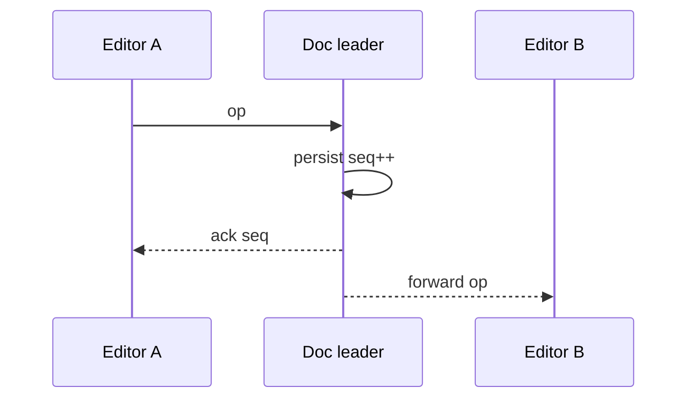
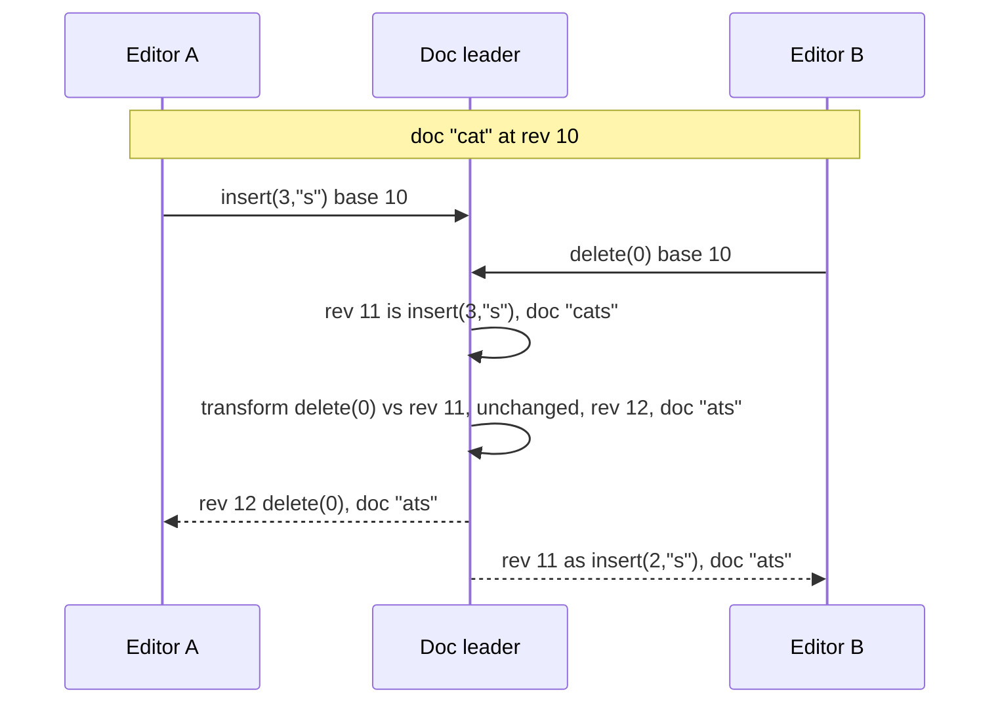

<!-- day-nav -->
[← Day 66 — Payment reconciliation](66-payment-reconciliation.md) · [Day 68 — File sync →](68-file-sync.md)

# Day 67 — Collaborative document

**Do now**

1. Set a timer.
2. Attempt the problem. Stop at the attempt line. Do not scroll.
3. Then read.

## Time box

40 minutes.

| Minutes | Do this |
|---|---|
| 0–12 | Attempt. Two editors. Persist concurrent edits and presence. Say what happens when they diverge. |
| 12–32 | Read. Last-write-wins on the whole doc is usually wrong. Name OT or CRDT at interview depth — not a paper seminar. |
| 32–40 | Say the sync protocol, persistence, and conflict UX. |

## Intent

Facing two editors in one document, leave able to persist concurrent edits and presence and say what you do when they diverge.

## Problem

> Design a collaborative document.
>
> Two or more people edit the same document at once. Edits should appear for everyone quickly. Presence (who is here, where their cursor is) is visible. When edits conflict, you must say what the product does.

## Attempt before reading

12 minutes. Do not scroll.

Write:

1. Primitive: whole-doc LWW, OT, CRDT, or section locking — pick and justify.
2. Wire protocol: ops over WebSocket; ack/persistence.
3. Presence: ephemeral vs durable.
4. Offline edit then reconnect.
5. What the user sees when merge cannot be automatic.

---

**Stop. Op-based sync with durable snapshot+log. Presence ephemeral. Named conflict rule.**

---

## Requirements

**In.** Docs up to **~2 MB** text-equivalent. **≤ 50** concurrent editors typical; hard cap **100**. Sub-second op fan-out. Persist every op or coalesced. Presence cursors. Version history coarse (snapshots).

**Assumptions.** **10 million** docs; **100k** concurrently open. One region authority per doc (sticky).

**Out.** Full Google-Docs feature clone, blames, comments deep dive, E2E encrypted collab without server merge (hard mode — refuse unless asked).

## Estimates

If 100k docs open × 2 ops/s average = **200k**/s ops — shard by doc_id. One hot doc 50 editors × 5 ops/s = **250**/s — single doc leader fine.

## API and data

WebSocket join `doc_id` with authz. Ops: `{client_id, seq, type, payload}`. Server assigns `server_seq`.

Snapshot store + op log since snapshot. Presence in memory / Redis with TTL.

## Design

### Default: OT with one sequencer per doc

Operational transformation (OT) means the server puts every edit in one order and rewrites ("transforms") late edits so they still land in the right place. Run it once on a tiny doc.

The doc is `cat` at **rev 10**. Positions count from 0.

1. Editor A types `s` at the end: `insert(3, "s")`, based on rev 10.
2. At the same moment, Editor B deletes the `c`: `delete(0)`, also based on rev 10.
3. A's op reaches the leader first. It becomes **rev 11**. Doc: `cats`.
4. B's op arrives still saying "based on rev 10". The leader transforms it against rev 11. The delete sits *before* A's insert, so it doesn't move. It becomes **rev 12**. Doc: `ats`.
5. The leader sends rev 12 to A. A applies `delete(0)` and gets `ats`.
6. The leader sends rev 11 to B. B already deleted a character in front of position 3, so B shifts the insert left by one: `insert(2, "s")`. B gets `ats`.

Everyone converges on `ats`, and nobody's keystroke vanished. That's the whole idea at interview depth.

**Client rule.** Each client keeps at most **one batch of ops in flight**. It types ahead locally, buffers new ops, and sends the next batch only after the leader acks the last one. So the leader only ever transforms one incoming batch against the ops it missed, and the client transforms its buffer against ops arriving from others.

**Gap cap.** An op based on rev `r` must be transformed against every op after `r`. Cap the gap (say **1,000 revs**). Past that, the client reloads a snapshot and replays its pending ops as fresh ones. Unbounded transform chains are how one reconnecting laptop stalls a whole doc.

### The alternative: a CRDT

A CRDT (conflict-free replicated data type) gives every character a unique id, like `(client_id, counter)`. An insert says "put `s` after character `A:17`", not "at position 3". A delete marks the character as gone (a tombstone) instead of removing it. Ops then merge in any order and every replica ends up the same.

- **Win.** No central transform. Offline-first and peer-to-peer get easy. The server still orders and persists ops for storage and catch-up, but it doesn't have to transform them.
- **Cost.** Metadata. A naive CRDT stores an id of 8–16 bytes for every 1-byte character and keeps tombstones forever. Real libraries compress runs of consecutive typing, but a doc that saw heavy rewriting still carries its deleted history until you garbage-collect it.
- **Quirk worth naming.** Two people typing at the same spot at once can see their characters interleave in some algorithms. Check what your library does before promising "it just merges".

Pick OT if you already run a per-doc leader. Pick a CRDT if offline-first is a hard requirement. Either way, **refuse last-write-wins on the whole document**: two people typing means one of them loses everything.

### Ack means durable

The leader does four things, in this order, for every op:

1. **Dedupe.** Each op carries `(client_id, client_seq)`. The leader keeps the last `client_seq` per client. A retry after a lost ack gets the old rev back and isn't applied twice.
2. **Assign** the next rev and transform if needed.
3. **Persist** to the op log: fsync locally or replicate to a quorum. Batch writes every ~10 ms (group commit) so 250 ops/s doesn't mean 250 disk flushes.
4. **Ack** the sender and **fan out** to everyone else.

Fan out before persisting and a crash can show text to B that the log never kept. B's screen now disagrees with the doc forever. That's a fork.

### Snapshots pinned to a rev

Every **1,000 ops or 5 minutes**, the leader writes a snapshot and records `covers_rev`. A late joiner loads the newest snapshot, then asks for ops after `covers_rev`. Worst-case catch-up: 1,000 ops × ~100 bytes ≈ **100 KB**, not the doc's whole history.

Only trim the op log below the oldest snapshot you keep. Version history is just the snapshots you keep, so its granularity is a product choice you can say out loud.

### Routing and fencing the leader

A directory (or consistent hashing plus a lease) maps `doc_id` to one leader. Each lease carries an **epoch** number. Every log write carries the epoch, and the log store rejects writes from an older one ([Day 36](36-a-leader-is-a-dependency.md)).

On failover, the new leader takes the lease with epoch + 1, reads the log tail, and starts at the last persisted rev. Clients reconnect with `last_rev` and get the gap. An old leader waking from a GC pause can't write, so it can't fork the doc.

### Presence is the real fan-out

Presence means who's here and where their cursor sits. Do the math on one busy doc with 50 editors:

- **Text.** 50 × 5 ops/s = 250 ops in, × 49 recipients ≈ **12,250 messages/s** out.
- **Cursors at 10 updates/s.** 50 × 10 = 500 in, × 49 ≈ **24,500 messages/s** out.

Cursors cost twice what text does. So throttle cursors to ~5/s, coalesce (send only the latest position), and drop them freely. Keep presence in memory with a ~30-second heartbeat TTL, never in the op log.

One catch: a cursor is a position, and positions move when others edit. Tag each cursor update with the rev it refers to, so receivers transform it like any other position.

### Offline and reconnect

The client stores pending ops with their base rev. On reconnect it sends that rev:

- **Gap within the cap.** The leader transforms the pending ops against the gap. Text merges automatically; both edits survive, maybe side by side.
- **Gap past the cap.** Reload the snapshot, rebase pending ops locally, send them fresh.

Text merges fine. **Fields** don't. If two people set the title or one table cell offline, apply the server order to that field only and show "Priya changed the title", with the other value one click away in history. Never let a field rule spread to the whole doc.

### Permissions

Check access at join. On revoke, the server closes the socket and rejects further ops from that client. Ops already persisted stay; the doc doesn't rewind.

### Worked numbers

- **Fleet.** 100k open docs × 2 ops/s = **200k ops/s**. At ~100 bytes each that's **20 MB/s, about 1.7 TB/day** of raw log, which snapshots and trimming keep bounded.
- **One hot doc.** 250 ops/s fits one leader easily. The cliff isn't throughput. It's a **fork**: two writers without fencing, a snapshot that doesn't name its rev, or an op applied twice.
- **Snapshot cost.** 2 MB doc every 1,000 ops at 250 ops/s is one 2 MB write every 4 seconds for the hottest doc; most docs snapshot on the 5-minute timer or not at all.

## Diagrams

Caption: "One sequencer per doc. Fan-out after durable."

Caption: "Both edits based on rev 10. The leader orders them; each side transforms what it missed. Everyone lands on `ats`."

## Failure the user sees

**Fork.** Two users see divergent permanent text with no merge path — unforgivable. Root causes: dual primary without fencing, snapshot/log mismatch, client applying ops twice without idempotency.

**Lost presence.** Cursors disappear on reconnect — OK; document must not.

**Offline collision.** Both edited same paragraph; on sync, conflict markers or CRDT merge — say which. Silent overwrite is a product bug.

**Snapshot without log prefix.** New joiner loads snapshot that is ahead of applied ops or behind — gap. Snapshot must name the log sequence it covers; catch-up applies ops after that seq.

**Huge doc.** Op amplify; snapshot more often; refuse unbounded history in RAM per connection.

## Trade-offs

**OT vs CRDT.** OT needs a central sequencer; CRDT merges without it but metadata grows. Pick for the infra you already have (day 53 leader vs day 42 conflicts).

**Presence in the durable log.** Refuse — presence is ephemeral.

**Name the refusal inside each alternative.** Against dual-primary write without merge: you refuse forks. Against presence as durable ops: you refuse log bloat and lying history. Against silent overwrite on offline sync: you refuse data loss dressed as sync. Against snapshot that does not pin a log seq: you refuse gap bugs. Against "Firestore will save us" without naming merge: you refuse a brand as a consistency story.

**10× editors on one doc.** Still one sequencer/shard for OT; CRDT metadata and fan-out of ops dominate — cap concurrent editors per doc if needed.

## Talking points

**If they store every cursor move.** "Presence ephemeral. Durable log is text ops."

**If they ask OT vs CRDT.** "OT with a doc leader if I already have one; CRDT if offline-first without a leader. I name conflict UX either way."

**If they ask how a late joiner loads.** "Snapshot at seq S + ops after S. Snapshot without S is a bug."

**If they ask about binary attachments.** "Pointers like chat; bytes day 14/68. Ops reference ids."

**If they ask what pages.** "Fork detectors (hash divergence), apply lag, snapshot age."

## Say this in the room

A collaborative doc is a durable op log with periodic snapshots pinned to a sequence, plus ephemeral presence that I refuse to put in the log. I pick OT with a per-doc sequencer or CRDT for offline-first — and I name the conflict UX when two offline edits collide. A fork — permanent divergent text — is unforgivable; fencing the writer and pinning snapshots to log seq are how we avoid it. New joiners load snapshot at seq S then catch up. Cursors can drop; characters cannot.

### Staff depth: fork is unforgivable

Dual writers without a merge rule, or snapshot/log mismatch, produce forks. Idempotent apply of ops; snapshot.seq mandatory.

**Presence.** Ephemeral channel; lossy OK.

**Offline.** Named merge or conflict markers — never silent clobber.

**What staff sounds like.** Snapshot pinned to seq; presence out of the log; fork named as the Sev-1.

### More probes, with the answer

**"What pages?"** Name the user-visible lag or error metric from Failure — not only CPU. **"What do you refuse?"** Pick one refusal from Trade-offs and say the lie it prevents. **"What is the sensitive assumption?"** The estimate that flips the design if wrong by 10×.

## Kit artifact

| Follow-up | You answer with |
|---|---|
| "Both edit the title." | Field-level rule or conflict marker; not silent whole-doc LWW. |
| "Laptop was offline for a day." | Transform pending ops if the gap is under the cap; otherwise reload snapshot and rebase locally. |
| "The ack got lost and the client resent." | Dedupe on `(client_id, client_seq)`; return the original rev. |
| "Old leader comes back after a pause." | Epoch on every log write; the store rejects the stale epoch. |
| "What's the most expensive traffic?" | Cursor fan-out, not text. Throttle, coalesce, keep it out of the log. |

## Design log

One line: OT vs CRDT choice, and how you fence the doc leader.

Next: [Day 68 — File sync](68-file-sync.md). Chunks, conflicts, lying clocks.

---

<!-- day-nav -->
[← Day 66 — Payment reconciliation](66-payment-reconciliation.md) · [Day 68 — File sync →](68-file-sync.md)
